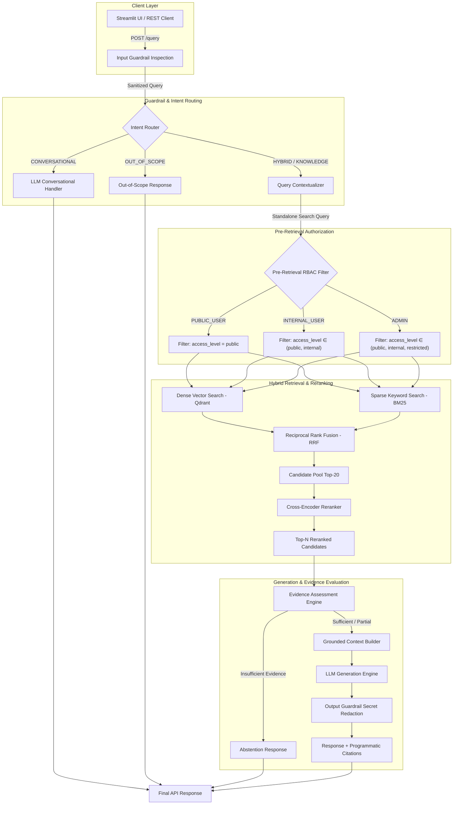

# Technical Documentation & Policy Intelligence RAG System
## Complete Project Overview, System Architecture & Engineering Reference Guide

---

## 1. Executive Summary & Core Mission

This system is an **advanced, production-oriented, enterprise-grade Retrieval-Augmented Generation (RAG) platform** designed to query complex technical documentation, operational runbooks, and enterprise security policies.

Unlike generic tutorial RAG implementations (*naive PDF text dump $\rightarrow$ fixed character chunking $\rightarrow$ basic vector DB $\rightarrow$ LLM*), this application solves the real-world challenges of accuracy, noise, security, context loss, and multi-tenant access control.

### Key Architectural Highlights
1. **Multi-Format Structure-Aware Ingestion:** Ingests Markdown, PDF, DOCX, HTML, PPTX, and TXT files, preserving heading hierarchies, breadcrumb lineages, and fenced code blocks (` ```python `) without syntax corruption.
2. **2-Tier Dynamic Intent Router:** Classifies user prompts into `CONVERSATIONAL`, `OUT_OF_SCOPE`, `KNOWLEDGE` (direct search), or `HYBRID` (conversational memory + domain knowledge) to eliminate unnecessary vector lookups.
3. **Conversational Memory Contextualization:** Re-writes follow-up questions in multi-turn dialogues into standalone, search-optimized queries.
4. **Pre-Retrieval Access Control (RBAC):** Applies authorization filters (`PUBLIC_USER`, `INTERNAL_USER`, `ADMIN`) **before** vector and lexical retrieval occurs, guaranteeing unauthorized document chunks never reach memory or the LLM.
5. **Hybrid Search Engine (Dense + BM25):** Fuses dense vector similarity (Qdrant with `all-MiniLM-L6-v2`) and sparse keyword search (BM25 with a custom regex tokenizer preserving hyphens, code symbols, and exact error codes like `ERR-4012`) via **Reciprocal Rank Fusion (RRF)**.
6. **Cross-Encoder Joint-Attention Reranking:** Re-scores the top fused candidate chunks using a Cross-Encoder transformer model (`cross-encoder/ms-marco-MiniLM-L-6-v2`) to eliminate false positives.
7. **Multi-Signal Evidence Assessment & Grounded Generation:** Evaluates evidence sufficiency (`Sufficient`, `Partial`, `Insufficient`) to trigger structured abstention ("I don't know") when information is missing or out of scope.
8. **Dual-Layer Guardrails:**
   - **Input Guardrails:** Detects direct/indirect prompt injections, jailbreaks, and input anomalies.
   - **Output Guardrails:** Redacts credentials/secrets and validates metadata citations against retrieved payload objects.
9. **Empirical Evaluation Framework:** Decouples retrieval evaluation (Recall@K, Precision@K, MRR, NDCG@K) from generation evaluation (Faithfulness, Citation Accuracy, Abstention Precision).

---

## 2. End-to-End System Architecture



---

## 3. Detailed Component Breakdown

### 3.1 Document Ingestion Pipeline (`backend/app/ingestion/`)
- **`loaders.py`:** Handles document loading across formats. Extracts YAML frontmatter from `.md` files and extracts text page-by-page from `.pdf` files via `pypdf`.
- **`parser.py`:** Parses Markdown structure into logical sections. Tracks header depth (`#`, `##`, `###`) and monitors fenced code block state (` ``` `) to prevent Python comments (`# comment`) from being misparsed as headings.
- **`chunker.py`:** Implements **Structure-Aware Chunking**. Prepends a lineage breadcrumb header to every chunk to eliminate the *Lost Context Problem*:  
  `[Document: FastAPI Guide | Lineage: FastAPI Core > Dependency Injection > Depends]`
- **`metadata.py`:** Binds universal schema metadata to each chunk payload (document_id, chunk_id, section, version, effective_date, status, access_level, authority).

---

### 3.2 Dual Indexing & Storage Engine (`backend/app/retrieval/`)
- **`service.py` (Embeddings):** Uses `SentenceTransformer("all-MiniLM-L6-v2")` to generate 384-dimensional dense vectors. Supports single string embedding and batched array processing.
- **`vector_store.py` (Qdrant Vector Store):** Wraps `QdrantClient` supporting local disk persistence (`./qdrant_data`), in-memory execution (`:memory:`), or Qdrant Cloud. Enforces Cosine distance vector search with native Qdrant payload filtering (`access_level`, `status`, `document_type`).
- **`bm25.py` (Sparse Lexical Search):** Implements `rank_bm25` (`BM25Okapi`). Employs a custom regex tokenizer `re.findall(r"[a-zA-Z0-9]+(?:[\-\._][a-zA-Z0-9]+)*", text.lower())` preserving exact error codes (`ERR-4012`), parameters (`--build-arg`), and code symbols.

---

### 3.3 Hybrid Search & Reranking (`backend/app/retrieval/`)
- **`hybrid.py`:** Executes Dense Vector Search and BM25 Sparse Search in parallel. Fuses candidate ranks using **Reciprocal Rank Fusion (RRF)**:
  $$\text{RRF\_Score}(c) = \frac{w_{\text{dense}}}{60 + \text{Rank}_{\text{dense}}(c)} + \frac{w_{\text{bm25}}}{60 + \text{Rank}_{\text{bm25}}(c)}$$
- **`reranker.py`:** Uses `CrossEncoder("cross-encoder/ms-marco-MiniLM-L-6-v2")`. Evaluates joint cross-attention between `(query, passage)` pairs for the Top-20 fused candidates to output the final Top-N (e.g. Top 5) candidates.

---

### 3.4 Intent Routing & Conversational Memory (`backend/app/generation/`)
- **`intent_router.py`:** Classifies user prompts into 4 operational intents:
  1. `CONVERSATIONAL`: Greetings, pleasantries ("hello", "thanks"). Bypasses vector retrieval.
  2. `OUT_OF_SCOPE`: System/chitchat unrelated to the index ("What is the capital of France?"). Returns immediate friendly boundary message.
  3. `KNOWLEDGE`: Direct, standalone technical queries.
  4. `HYBRID`: Queries requiring multi-turn conversational history context.
- **`contextualizer.py`:** Transforms ambiguous follow-up questions (e.g. *"What about its RTO?"*) into standalone search queries using preceding dialogue turns.

---

### 3.5 Grounded LLM Generation & Evidence Assessment (`backend/app/generation/` & `answerability/`)
- **`evaluator.py` (Answerability):** Assesses retrieved chunk relevance scores against configurable thresholds (`RELEVANCE_THRESHOLD = 0.3`). Categorizes evidence into `Sufficient`, `Partial`, or `Insufficient`.
- **`prompts.py` & `context.py`:** Wraps retrieved text in `<retrieved_data>` tags as **UNTRUSTED REFERENCE DATA**. Instructs the LLM to answer strictly from provided evidence and abstain when evidence is missing.
- **`llm.py`:** Multi-provider client interface supporting Google Gemini (`gemini-2.5-flash`), OpenAI (`gpt-4o-mini`), Groq, or local Ollama models.

---

### 3.6 Security & Guardrail Architecture (`backend/app/security/`)
- **`input_guardrails.py`:** Inspects incoming queries for jailbreak patterns (*"ignore previous instructions"*, *"system override"*), SQL/Command injection attempt signatures, and length violations.
- **`access_control.py`:** Pre-retrieval role mapping (`PUBLIC_USER` $\rightarrow$ `['public']`, `INTERNAL_USER` $\rightarrow$ `['public', 'internal']`, `ADMIN` $\rightarrow$ `['public', 'internal', 'restricted']`).
- **`output_guardrails.py`:** Scans generated answers to redact API keys, SSH private keys, and passwords, and validates metadata citations.

---

## 4. Dataset & Data Strategy (`data/`)

The system operates over a dual dataset layout:

1. **`data/TrueData/` (Clean Authoritative Documentation):**
   - Contains core system manuals, SLA specifications, auto-scaling guides, cronjob specifications, and queue management docs (`architecture.pptx`, `cronjobs.docx`, `job_management.html`, `monitor_job.docx`, `parallel_work_queue.txt`, `pods_autoscale.html`).
2. **`data/NoisyData/` (Complex & Multi-Format Technical Corpus):**
   - 50+ real-world technical PDFs, slides, and papers covering 100G Networking, C++ Stack Unwinding, Intel 5-Level Paging, Skiplists, Locality-Sensitive Hashing, Memory Consistency, and Linux Kernel Internals.

---

## 5. File & Directory Reference Map

```
c:\Users\OM\Desktop\rag\
├── DATASET_DESIGN.md             <-- Dataset Strategy & Metadata Schema Blueprint
├── SYSTEM_ARCHITECTURE.md        <-- Architecture & Security Flow Specification
├── COMPLETE_PROJECT_AND_ARCHITECTURE_GUIDE.md <-- Master Technical Specification
├── Dockerfile                    <-- Unified Docker Build File
├── Dockerfile.api                <-- FastAPI Backend Dockerfile
├── Dockerfile.streamlit          <-- Streamlit Frontend Dockerfile
├── docker-compose.yml            <-- Multi-container Docker Compose setup
├── requirements.txt              <-- Python Dependencies Manifest
│
├── backend/app/
│   ├── main.py                   <-- FastAPI Application Lifecycle & Middleware Entrypoint
│   ├── api/
│   │   ├── routes_documents.py   <-- Document Ingestion & Management REST Endpoints
│   │   ├── routes_health.py      <-- System Readiness & Uptime Probe Endpoint
│   │   └── routes_query.py       <-- RAG Query Execution Endpoint
│   ├── core/
│   │   ├── config.py             <-- Pydantic Settings & Environment Manager
│   │   └── logging.py            <-- Structured Logging Handler
│   ├── schemas/
│   │   ├── documents.py          <-- Document Metadata Validation Schemas
│   │   └── query.py              <-- Query Request, Citation & Response Schemas
│   ├── ingestion/
│   │   ├── loaders.py            <-- Markdown Frontmatter & PDF Loaders
│   │   ├── parser.py             <-- Structure Parser & Code Block Tracker
│   │   ├── chunker.py            <-- Lineage Breadcrumb Chunker
│   │   └── metadata.py           <-- Universal Schema Payload Binder
│   ├── embeddings/
│   │   └── service.py            <-- Dense Embedding Service
│   ├── retrieval/
│   │   ├── vector_store.py       <-- Qdrant Vector Store & Payload Filtering
│   │   ├── dense.py              <-- Pre-Retrieval Authorized Dense Search
│   │   ├── bm25.py               <-- Sparse Lexical Keyword Search
│   │   ├── hybrid.py             <-- Reciprocal Rank Fusion (RRF) Hybrid Search
│   │   └── reranker.py           <-- Cross-Encoder Joint-Attention Reranker
│   ├── generation/
│   │   ├── prompts.py            <-- Grounded Prompts & Injection Defenses
│   │   ├── context.py            <-- Context Builder & Metadata Formatter
│   │   ├── contextualizer.py     <-- Conversational Contextualizer
│   │   ├── intent_router.py      <-- 2-Tier Dynamic Intent Router
│   │   ├── llm.py                <-- Unified Multi-Provider LLM Client
│   │   └── service.py            <-- Generation Pipeline Orchestrator
│   ├── security/
│   │   ├── access_control.py     <-- Role-Based Access Control Logic
│   │   ├── input_guardrails.py   <-- Input Validation & Injection Scanner
│   │   └── output_guardrails.py  <-- Secret Redaction & Citation Guardrails
│   ├── answerability/
│   │   ├── evaluator.py          <-- Evidence Assessment & Abstention Evaluator
│   │   └── models.py             <-- Answerability Data Schemas
│   └── services/
│       └── document_service.py   <-- File Ingestion Orchestrator Service
│
├── frontend/
│   └── app.py                    <-- Interactive Streamlit UI Dashboard
│
├── data/
│   ├── README.md                 <-- Data Strategy Manifest & Attribution Notes
│   ├── TrueData/                 <-- Clean System & SLA Documentation
│   └── NoisyData/                <-- Multi-Format Technical PDFs & Papers
│
├── evaluation/
│   ├── dataset.json              <-- 30 Benchmark Test Cases
│   └── run_eval.py               <-- Automated Metric Evaluator & Failure Analysis
│
└── tests/                        <-- Comprehensive Pytest Integration Suite
    ├── test_api.py
    ├── test_bm25_retrieval.py
    ├── test_conversational_memory.py
    ├── test_dense_retrieval.py
    ├── test_embeddings.py
    ├── test_eval.py
    ├── test_generation.py
    ├── test_health.py
    ├── test_hybrid_retrieval.py
    ├── test_ingestion.py
    ├── test_reranker.py
    ├── test_routes_intent.py
    ├── test_security.py
    └── test_vector_store.py
```

---

## 6. Deployment & Cloud Architecture

The application is engineered for **100% Free Public Cloud Deployment ($0.00/month)**:

- **Vector Storage:** **Qdrant Cloud Free Tier** (1 GB Persistent Cluster).
- **Backend Service:** **Google Cloud Run** (Always Free Tier, Scale-to-Zero `--min-instances=0`, Hard Capped `--max-instances=1`) or **Render.com Free Web Service**.
- **Frontend UI:** **Streamlit Community Cloud** (Free public hosting connected to GitHub).
- **LLM Inference:** **Google AI Studio (Gemini 2.5 Flash)** or **Groq Cloud API**.
- **Stateless Persistence:** Because Qdrant Cloud handles vector index storage externally, container scaling or restarts never lose indexed knowledge base data.
