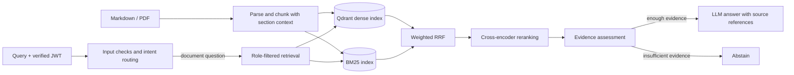

# Knowvia AI — Document Q&A with Hybrid RAG

Knowvia AI answers questions over technical and policy documents through a FastAPI backend and Streamlit interface. I built it to compare retrieval approaches and measure how reranking, evidence-based abstention, and access filtering affect answer quality and latency. It combines dense and BM25 search, citation-guided LLM generation, JWT-based role filtering, and evaluation/tracing tools.

> **Project scope:** This is a portfolio prototype, not a production security system. Demo identities are stored in source code, guardrails use pattern matching and regular expressions, and generated answers/citations still require validation. Use only non-sensitive content.

## Live demo

- **Streamlit app:** [Open Knowvia AI](https://knowvia-rag.streamlit.app/)

## Engineering highlights

- **Hybrid retrieval:** `all-MiniLM-L6-v2` embeddings (384 dimensions) searched in Qdrant, combined with BM25 keyword search using weighted Reciprocal Rank Fusion (`k=60`).
- **Reranking and abstention:** `cross-encoder/ms-marco-MiniLM-L-6-v2` reranks candidates. An evidence evaluator classifies support as strong, partial, or insufficient before generation. Sigmoid-scaled reranker scores are not calibrated probabilities.
- **Document-aware ingestion:** Markdown and PDF parsing, section breadcrumbs, and chunking targeted at 1,800 characters with 250-character overlap. These are character settings, not token counts.
- **Role-based retrieval:** FastAPI verifies a JWT and applies the server-assigned role to both Qdrant and BM25 retrieval filters. The current identity store is a static demo implementation, not an external identity provider.
- **Observability:** Optional Langfuse traces record applicable pipeline stages. The latency script aggregates p50/p95 latency, provider-reported tokens, and cost calculated from configured pricing constants.

## How a question is answered



The model receives retrieved passages marked as untrusted context and is instructed to cite them. Citation formatting and factual grounding are not guaranteed by the prompt alone; evaluation and manual review remain important.

## Evaluation results

The repository contains 30 development and 30 held-out queries. They were AI-generated from the project corpus, share source documents across splits, and include paraphrases. Treat the scores below as **small, preliminary portfolio evidence**, not as an independent benchmark.

| Evaluation | Result | How to read it |
| --- | --- | --- |
| Document retrieval, hybrid + reranker | Recall@5 **1.00**, MRR **0.856**, nDCG@5 **0.893** | Document-level results on 22 labeled held-out questions; there are no ground-truth chunk IDs, so chunk-level retrieval scores are unavailable. |
| Abstention, hybrid + reranker + abstention | Precision **0.545**, recall **1.00** | Evaluated on all 30 held-out questions; the low precision means some answerable questions were incorrectly abstained on. |
| Generation quality | Faithfulness **0.707**, answer relevancy **0.923** | 30 development questions judged by a separate model. One generator call hit a rate limit and used a mock fallback; the results need human review. |
| Live latency and usage | 30 Langfuse traces; total latency p50 **8.56 s**, p95 **31.73 s** | Complete token usage and estimated cost were available for 19/30 queries: **2,833 tokens/query** and **$0.000338/query on those 19**. The other 11 are unavailable and excluded from those averages. |

In the held-out retrieval ablation, adding the cross-encoder to hybrid search kept document Recall@5 at **1.00**, while MRR rose from **0.811 to 0.856** and nDCG@5 from **0.860 to 0.893**. Median latency also increased from about **73 ms to 392 ms** in that run. This illustrates the ranking/latency trade-off the project measures; the small, overlapping dataset limits how broadly to generalize the result.

The live latency run used Groq and Qdrant Cloud, so it required network access and consumed API quota. Cost is an estimate from the configured GPT-OSS 20B rates, not a provider invoice. The high latency tail is a current optimization target. Detailed commands, results, and limitations are in [`evaluation/results.md`](evaluation/results.md); the machine-readable latency run is [`evaluation/results/latency_report_development.json`](evaluation/results/latency_report_development.json).

## Stack

Python 3.11 · FastAPI · Streamlit · Qdrant · Sentence Transformers · BM25Okapi · Cross-Encoder · Groq/Gemini clients · JWT · Langfuse · Docker Compose · GitHub Actions

## Run locally

### 1. Install

```powershell
git clone https://github.com/omrohitchannoji/knowvia-rag.git
cd knowvia-rag
python -m venv venv
. .\venv\Scripts\Activate.ps1
pip install -r requirements.txt
```

On macOS/Linux, activate with `source venv/bin/activate`.

### 2. Configure `.env`

Copy `.env.example` to `.env` and set the LLM, vector-store, and JWT settings you intend to use. Keep real credentials out of Git. Configure Langfuse only if you want remote tracing.

### 3. Start the API and UI

Use two PowerShell terminals. The UI must be pointed at the local API; otherwise it may use the deployed backend URL from its default configuration.

**Terminal 1 — API:**

```powershell
.\venv\Scripts\Activate.ps1
uvicorn backend.app.main:app --host 127.0.0.1 --port 8000 --reload
```

If Windows blocks port 8000, use `8765` here and in the UI command below.

**Terminal 2 — Streamlit:**

```powershell
.\venv\Scripts\Activate.ps1
$env:API_BASE_URL = "http://127.0.0.1:8000/api/v1"
streamlit run frontend/app.py
```

For port `8765`, set `$env:API_BASE_URL = "http://127.0.0.1:8765/api/v1"` instead. Open the Streamlit URL printed in the terminal. The API docs are at `http://127.0.0.1:8000/docs` (or port `8765`).

### Tests and evaluation commands

```bash
pytest -m "not external" -v
python evaluation/run_eval.py --split development --mode all
```

Generation and latency evaluation may call configured LLMs and consume API quota:

```bash
python evaluation/run_generation_eval.py --split development
python scripts/latency_report.py --split development
```

## Authentication notes

Protected API endpoints require a Bearer JWT. Roles are assigned after demo credential verification and used for pre-retrieval access filters. The included user store is hard-coded for demonstration; replace it with a managed identity provider and rotate the JWT secret before any non-demo deployment. `/api/v1/auth/token` accepts the same JSON schema as `/api/v1/auth/login`; despite its name, it is not the standard OAuth2 form-encoded password flow.

## License

MIT. See [`LICENSE`](LICENSE).
