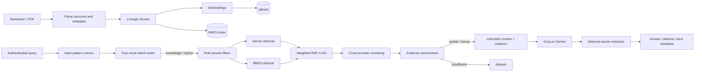

# 🧠 Knowvia AI — Secure, Evaluated RAG Platform

[](https://www.python.org/downloads/release/python-3110/)
[](https://fastapi.tiangolo.com/)
[](https://qdrant.tech/)
[](https://opensource.org/licenses/MIT)

Knowvia AI is a portfolio application for asking questions over technical and policy documents. It combines dense and BM25 retrieval, Reciprocal Rank Fusion (RRF), cross-encoder reranking, evidence-based abstention, role-filtered retrieval, and citation-backed generation. The repository also contains retrieval ablations, a generation-quality evaluation, and optional Langfuse tracing.

> **Scope:** This is a demonstration project, not a production-ready security or identity platform. The included demo accounts are stored in source code, and input/output safeguards use heuristics and regular expressions. Do not use the public demo endpoint for sensitive information.

## Demo and endpoints

| Resource | Link | Notes |
| --- | --- | --- |
| Streamlit UI | [Knowvia AI demo](https://knowvia-rag.streamlit.app/) | Availability may change. |
| FastAPI API | `http://13.205.104.107:8000/api/v1` | HTTP demo endpoint; do not send sensitive data. |
| API documentation | `http://13.205.104.107:8000/docs` | Available when the backend is online. |
| Health endpoint | `http://13.205.104.107:8000/api/v1/health` | Reports app metadata and process uptime; does not probe every dependency. |

## What it demonstrates

- **Hybrid retrieval:** `sentence-transformers/all-MiniLM-L6-v2` embeddings (384 dimensions) in Qdrant and BM25Okapi keyword retrieval, fused with weighted RRF (`k=60`).
- **Reranking and evidence checks:** `cross-encoder/ms-marco-MiniLM-L-6-v2` scores candidates; evidence assessment classifies support as strong, partial, or insufficient. Sigmoid-scaled scores are not calibrated probabilities.
- **Document structure:** Markdown/PDF parsing, section lineage breadcrumbs, and chunking targeted at 1,800 characters with 250 characters of overlap. These are character limits, not token counts; some atomic blocks may exceed the target.
- **Role-filtered retrieval:** JWT claims provide the role used by Qdrant and BM25 access filters. The example identity store is static and intended only for local/demo use.
- **Query routing:** Four routes—`CONVERSATIONAL`, `OUT_OF_SCOPE`, `HYBRID`, and `KNOWLEDGE`. Pattern-based routing may avoid a router-model call; a conversational answer can still call the generation model.
- **Grounded answer flow:** Retrieved text is marked as untrusted context and the prompt requests `[Source X]` citations. Generation can still omit or misuse citations.
- **Safeguards:** Known injection patterns are checked before retrieval and selected secret-like strings are redacted from output. These are best-effort safeguards, not comprehensive security controls.
- **Observability:** Optional Langfuse traces record applicable stage latency and token usage when exposed by the provider. Costs are estimates based on configured per-token rates.

## Architecture



### Retrieval and answer flow

1. Documents are parsed and split into lineage-aware chunks; embeddings and BM25 entries are built through the ingestion pipeline.
2. Requests pass input checks and intent routing. For knowledge queries, the authenticated role is applied to both dense and sparse retrieval.
3. Dense and lexical candidate ranks are combined using weighted RRF, then reranked with a cross-encoder.
4. The evidence evaluator checks whether support is strong, partial, or insufficient. The generator receives marked context and citation instructions for supported answers.
5. The response includes citations, abstention/evidence fields, latency, and optional trace and token-cost metadata.

## Authentication and authorization

Protected endpoints use a signed Bearer JWT. The server assigns the role after credential verification; caller-supplied `user_role` values do not grant access. Access levels are filtered before candidates are returned:

- `PUBLIC_USER`: public documents
- `INTERNAL_USER`: public and internal documents
- `ADMIN`: public, internal, and restricted documents

`POST /api/v1/auth/login` accepts a JSON username/password body and issues a JWT. `/api/v1/auth/token` is an alias using the same JSON schema; it is not the standard OAuth2 form-encoded password flow. `GET /api/v1/auth/me` returns the verified identity.

The demo users and passwords are defined in `backend/app/security/users.py`. Replace this store and rotate `JWT_SECRET_KEY` before any non-demo deployment. A missing JWT secret raises an error when token signing/verification is attempted; it is not a general dependency-readiness check.

## API examples

### Get a demo token

```bash
curl -X POST http://127.0.0.1:8000/api/v1/auth/login \
  -H "Content-Type: application/json" \
  -d '{"username":"public_guest","password":"GuestPass2026!"}'
```

Use the returned `access_token` as `Authorization: Bearer <token>` for protected endpoints. The credentials above are public demo credentials, not secrets.

### Query

```bash
curl -X POST http://127.0.0.1:8000/api/v1/query \
  -H "Authorization: Bearer <JWT_TOKEN>" \
  -H "Content-Type: application/json" \
  -d '{"query":"What does the policy say about access?","top_k":5}'
```

Response fields include `query`, `answer`, `citations` (`source_index`, `document_name`, `section`, `page`, `version`, `access_level`, and `source_url`), `retrieved_chunks_count`, `is_abstained`, `latency_ms`, `evidence_status`, `trace`, `token_usage`, and `estimated_cost_usd`. Optional trace and cost fields may be null/unavailable.

### Other endpoints

- `GET /api/v1/documents/list` — list documents visible to the caller.
- `POST /api/v1/documents/upload` — upload Markdown or PDF for indexing.
- `DELETE /api/v1/documents/{document_id}` — delete a document (admin role required); BM25 is reindexed from retained chunks.
- `GET /api/v1/health` — application metadata and process uptime, not a full dependency health check.

## Tracing, token usage, and cost

Set `LANGFUSE_ENABLED`, `LANGFUSE_PUBLIC_KEY`, `LANGFUSE_SECRET_KEY`, and optionally `LANGFUSE_HOST` to enable Langfuse export. `TRACE_REDACT_PAYLOADS=True` is the default; sensitive payload fields are omitted/redacted, but tracing should still be configured and reviewed for the deployment environment.

The tracer records applicable stages: `guardrail`, `router`, `dense_retrieval`, `bm25_retrieval`, `fusion`, `reranking`, and `generation`. A route may skip some stages. Token usage is recorded when the provider client returns it; unavailable usage stays unavailable. Estimated cost uses the rates configured in `backend/app/core/config.py`, not a live provider invoice. As of the repository's current configuration, Groq `openai/gpt-oss-20b` is set to $0.075/M input tokens and $0.30/M output tokens; other listed models have unset rates. Cached-input discounts are not modeled. See [Groq GPT-OSS 20B pricing](https://console.groq.com/docs/model/openai/gpt-oss-20b).

Run the latency report with:

```bash
python scripts/latency_report.py --split development
```

This command runs the configured evaluation path and may call the configured LLM/router. It can consume API quota. Offline/mock runs produce latency data but will not have provider usage or cost.

## Evaluation and current evidence

The repository includes an AI-generated dataset of 60 queries split into 30 development and 30 held-out-test queries. Both splits share underlying corpus documents and contain related paraphrases. The labels and questions are not independently authored, and the test split is not a representative external benchmark.

K-1 retrieval ablation uses a local in-memory index and makes no LLM generation calls or Qdrant Cloud writes. The current held-out run reports document-level retrieval metrics for 22/30 cases with a non-null expected document, abstention metrics for all 30 cases, and no chunk-level metric because **none of the questions has ground-truth chunk IDs**. These results are preliminary and the deterministic router/abstention logic was tuned on development data. The current run and per-question judgments are in [`evaluation/results.md`](evaluation/results.md) and [`evaluation/results/eval_run_20261127_183745_held_out_test_k1_no_llm.json`](evaluation/results/eval_run_20261127_183745_held_out_test_k1_no_llm.json). Earlier runs are historical artifacts.

K-2 generation evaluation scored 30 development questions using a separate Groq judge. The recorded means are faithfulness **0.7067** and answer relevancy **0.9233**. One generator request hit a rate limit and used the offline mock fallback; inspect the per-question CSV and manually review the pending sample before treating these as final quality claims.

The latest live K-4 latency run (2026-11-28) created 30 Langfuse traces. Complete provider usage was available for 19/30 queries: **2,832.58 average tokens/query** and **$0.000338 average estimated cost/query among those 19** using the configured GPT-OSS 20B pricing. Usage and cost were unavailable for 11 queries, so these averages do not cover all 30. Per-stage p50/p95 values and the full run details are in [`evaluation/results.md`](evaluation/results.md) and [`evaluation/results/latency_report_development.json`](evaluation/results/latency_report_development.json). This was a live run against Groq and Qdrant Cloud and may consume API quota.

Run the evaluations (generation evaluation makes provider calls and may consume quota):

```bash
# Retrieval and abstention ablation; local in-memory index
python evaluation/run_eval.py --split development --mode all

# Generation quality; calls generator and judge providers
python evaluation/run_generation_eval.py --split development

# Per-stage latency; may call configured model/router
python scripts/latency_report.py --split development
```

Full commands, metrics, limitations, and historical runs are recorded in [`evaluation/results.md`](evaluation/results.md). The 20-case manual review sample is [`evaluation/human_review_sample.json`](evaluation/human_review_sample.json); its labels are pending human annotation.

## Local development

### 1. Create and activate a virtual environment

```powershell
git clone https://github.com/omrohitchannoji/knowvia-rag.git
cd knowvia-rag
python -m venv venv
. .\venv\Scripts\Activate.ps1
pip install -r requirements.txt
```

On Linux/macOS, activate with `source venv/bin/activate`.

### 2. Configure environment

Copy `.env.example` to `.env`, then set the values you need. Keep `.env` private and never commit API keys.

```ini
APP_NAME=Knowvia AI
APP_ENV=development
DEBUG=true
JWT_SECRET_KEY=replace_with_a_long_random_secret
JWT_ALGORITHM=HS256
LLM_PROVIDER=groq
LLM_MODEL=openai/gpt-oss-20b
GROQ_API_KEY=your_groq_api_key
VECTOR_DB_TYPE=qdrant
QDRANT_STORAGE_PATH=./qdrant_data
COLLECTION_NAME=tech_doc_collection
EMBEDDING_PROVIDER=sentence_transformers
EMBEDDING_MODEL=all-MiniLM-L6-v2
EMBEDDING_DIMENSION=384
```

Configure Langfuse variables only if you want remote traces. Verify `.env` remains ignored by Git before adding any credentials.

### 3. Run tests and start the app

```bash
pytest -m "not external" -v
```

```bash
# Terminal 1: API
uvicorn backend.app.main:app --host 127.0.0.1 --port 8000 --reload

# Terminal 2: Streamlit UI
streamlit run frontend/app.py
```

The API docs are at `http://127.0.0.1:8000/docs` when the backend is running. Local mode can still require model downloads or configured external services depending on the selected settings.

## Deployment overview

The repository has been configured for a Streamlit Community Cloud frontend, an AWS EC2 FastAPI backend, Qdrant Cloud, and Groq. Public endpoint availability and security posture can change; check the deployment before relying on it. The published backend URL uses HTTP, so it is not appropriate for transmitting secrets or private document content.

## License

This project is licensed under the **MIT License**. See [`LICENSE`](LICENSE).
