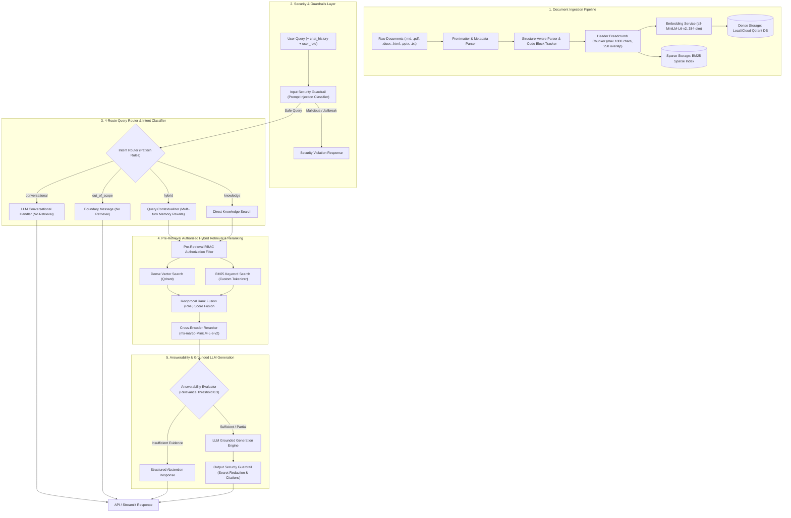

# Technical Documentation & Policy Intelligence RAG System
## Complete System Architecture, Workflow Process & Component Guide

---

## 1. Executive System Overview

The **Technical Documentation & Policy Intelligence RAG System** is an enterprise-grade Retrieval-Augmented Generation (RAG) platform engineered for processing, securing, searching, and answering questions from clean system specifications, operational runbooks, technical PDFs, and multi-format engineering documentation (`TrueData` & `NoisyData`).

### Core Engineering Features:
- **Structure-Aware Multi-Format Data Ingestion:** Parses Markdown, PDF, DOCX, HTML, PPTX, and TXT documents while preserving metadata, section lineage, and header breadcrumbs.
- **Pre-Retrieval Role-Based Access Control (RBAC):** Enforces strict data access constraints (`PUBLIC_USER`, `INTERNAL_USER`, `ADMIN`) at the vector database retrieval level.
- **2-Tier 4-Channel Query Intent Router:** Routes input queries into 4 explicit paths (`conversational`, `knowledge`, `hybrid`, `out_of_scope`) to optimize latency (**< 1ms for greetings**), eliminate token waste, and disambiguate multi-turn chat history.
- **Hybrid Score Fusion (Dense Vector + Sparse BM25):** Fuses dense semantic vector embeddings (`all-MiniLM-L6-v2`) with sparse keyword token matching (`BM25Okapi`) using Reciprocal Rank Fusion (RRF).
- **Cross-Encoder Reranking with Sigmoid Normalization:** Reranks candidate chunks with `cross-encoder/ms-marco-MiniLM-L-6-v2` and applies Sigmoid logit-to-probability score normalization in $[0, 1]$ to prevent false threshold abstentions.
- **Grounded LLM Generation & Citation Engine:** Invokes Google Gemini 2.5 Flash / Groq LLMs with strict anti-hallucination directives and maps verified inline citations (`[Source 1]`).
- **Dual Security Guardrails:** Includes pre-retrieval prompt injection classification and post-generation secret/credential redaction.

---

## 2. Complete Architecture Diagram

---

## 3. Key Component Specifications

### 3.1 Pre-Retrieval Authorization (RBAC)
Filter criteria are evaluated in the vector database query filter **before** nearest-neighbor calculation:
- `PUBLIC_USER`: Allowed `access_level IN ['public']`
- `INTERNAL_USER`: Allowed `access_level IN ['public', 'internal']`
- `ADMIN`: Allowed `access_level IN ['public', 'internal', 'restricted']`

### 3.2 Dual Search Engine & Fusion
- **Dense Vector Search:** Encodes text via `all-MiniLM-L6-v2` (384 dimensions) and queries Qdrant with Cosine distance.
- **Sparse BM25 Search:** Tokenizes text preserving hyphens, code symbols, and exact identifiers (`re.findall(r"[a-zA-Z0-9]+(?:[\-\._][a-zA-Z0-9]+)*", text.lower())`).
- **Score Fusion:** Combines ranks using Reciprocal Rank Fusion:
  $$\text{RRF\_Score}(c) = \frac{w_{\text{dense}}}{60 + \text{Rank}_{\text{dense}}(c)} + \frac{w_{\text{bm25}}}{60 + \text{Rank}_{\text{bm25}}(c)}$$

### 3.3 Cross-Encoder Reranking
Scores candidate pairs `(query, chunk_text)` using `cross-encoder/ms-marco-MiniLM-L-6-v2` with full cross-attention, ensuring precise ranking for the final Top-N context chunks.

---

## 4. Deployment Model

- **Vector DB:** Qdrant Cloud Free Tier / Local Qdrant Engine.
- **Backend API:** FastAPI running inside stateless Docker container (Google Cloud Run / Render).
- **Frontend UI:** Streamlit Community Cloud.
- **LLM API:** Google Gemini 2.5 Flash / Groq / OpenAI.
